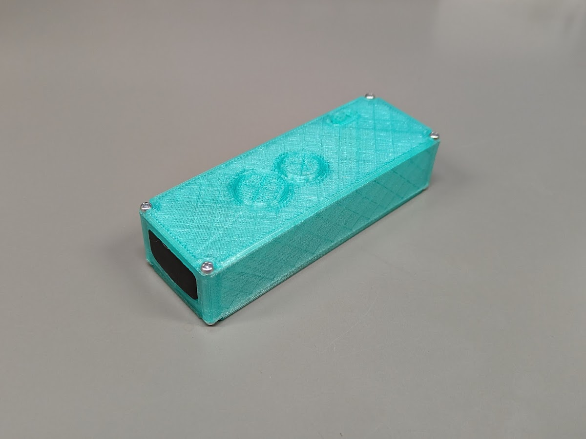
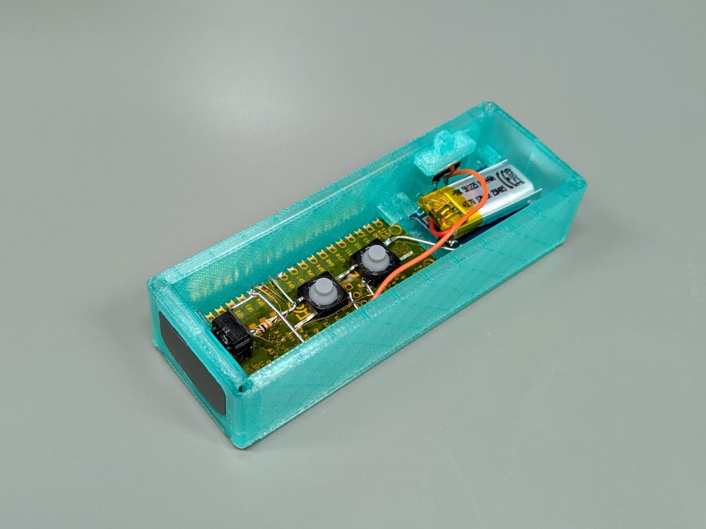
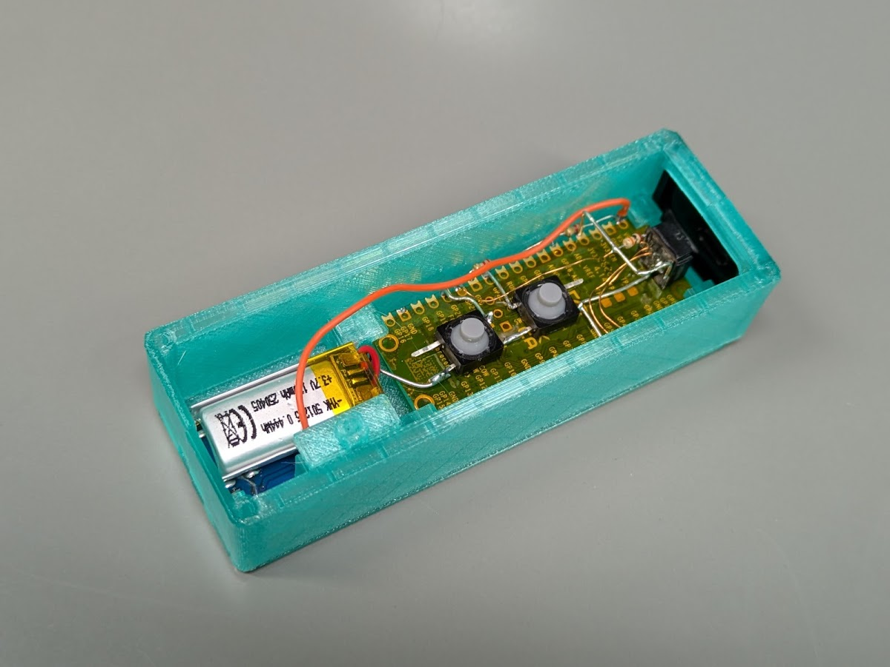

# WiimoteIR-BLEmouse

<!--description
WiiリモコンのIRセンサを利用したマウス。Wiiリモコンのように画面に向けてマウスを操作できる。BLE版
description-->

## 概要

Wiiリモコンのように画面に向けてマウスを操作できる、WiiリモコンのIRセンサを利用したマウスの設計を改良、BLE化した。
過去作→(<../WiimoteIR-HIDmouse>)

## 改良および変更点

- マイコンをArduino Pro MicroからRaspberry Pi Pico Wに変更
  - BLE化
- LiPoバッテリーを搭載
  - Type-C充電
- ボタン数の削減
  - 上下左右方向キー + 左右クリック から 左右方向キーのみに
  - これによってスライド発表に必要なキーを残しつつ、部品点数を削減
- WiiリモコンのIRセンサに供給するクロック(25MHz)をRaspberry Pi Picoのシステムクロックから供給
  - 前回はマイコンとは別に25MHzの発振子をつけていたが、これにより部品点数が削減

